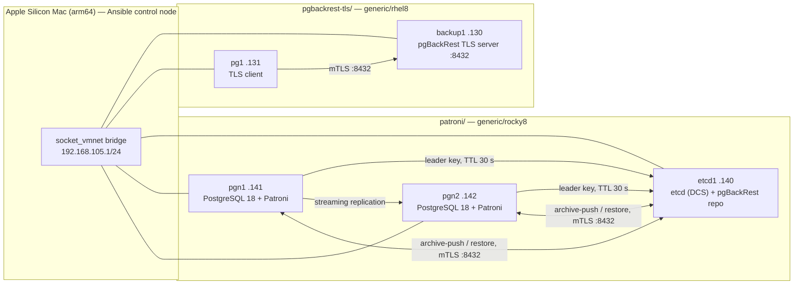

# postgres-ha-lab

A production-shaped PostgreSQL cluster on one laptop: Patroni and etcd on amd64 Rocky 8 guests, pgBackRest over mutual TLS — and the failure, rebuild and restore actually performed, with the numbers that came off the runs.

[](https://github.com/technobasant/postgres-ha-lab/actions/workflows/ci.yml)

A cluster that has never failed is a cluster whose recovery path is a hypothesis. Most Patroni walkthroughs stop at `patronictl list` showing a Leader and a Replica; most pgBackRest walkthroughs back up a single server that never moves. I wanted a rig where the primary dies badly, a replica is thrown away, a table is dropped on purpose, and the backup repository has to keep working while the primary changes underneath it.

So it runs on virtual machines rather than containers — a Docker network cannot produce clock drift, systemd ordering, firewalld or a package manager refusing a key import — and on amd64 guests emulated on Apple Silicon, because a lab that lies about the instruction set makes every later packaging and timing claim suspect.

Write-up and case study: [the lab as a case study](https://basantbhattarai.com.np/work/patroni-ha-backup-lab/).

## What it proves

| Part | Claim | Write-up |
| --- | --- | --- |
| [`fabric/`](fabric) | amd64 guests under QEMU TCG on Apple Silicon with a real shared L2 network (host ↔ VM ↔ VM), on its own subnet | [amd64 Vagrant labs on Apple Silicon](https://basantbhattarai.com.np/writing/amd64-vagrant-labs-apple-silicon-socket-vmnet/) |
| [`pgbackrest-tls/`](pgbackrest-tls) | A dedicated pgBackRest repository host serving mutual TLS, configured entirely by Ansible, proven before any Postgres exists | [Dedicated pgBackRest TLS on RHEL 8 with Ansible](https://basantbhattarai.com.np/writing/pgbackrest-tls-ansible-rhel8/) |
| [`patroni/`](patroni) | Patroni promotes on leader loss with etcd holding the leader key; the old primary rejoins via `pg_rewind`; pgBackRest archives through the DCS, rebuilds a replica from the repo and restores a dropped table to a point in time | [Patroni HA on PostgreSQL 18](https://basantbhattarai.com.np/writing/patroni-postgresql-18-rocky8-etcd-failover/) · [pgBackRest against a Patroni cluster](https://basantbhattarai.com.np/writing/pgbackrest-patroni-cluster-backup-pitr/) |

## Topology



Every guest has two NICs: QEMU user networking for `vagrant ssh`, and a `socket_vmnet` NIC on `192.168.105.0/24` for everything Ansible, Patroni and pgBackRest actually use.

## Versions

| Component | Version |
| --- | --- |
| Host | macOS on Apple Silicon (arm64) |
| QEMU (TCG, `qemu-system-x86_64`) | 11.0.3 |
| Vagrant / vagrant-qemu | 2.4.9 / 0.6.3 |
| Guests | `generic/rocky8` (Rocky 8.8, repos serving 8.10), `generic/rhel8`, `generic/ubuntu2204`, `generic/centos8` |
| PostgreSQL | 18.6 (PGDG) |
| Patroni | 4.1.5 (`patroni-etcd`, with its own Python 3.12.13) |
| etcd | 3.7.0 (PGDG extras) |
| pgBackRest | 2.59.0 (PGDG) |
| Ansible control node | ansible-core 2.15.13 on Python 3.12 — guests ship Python 3.6, so ansible-core must stay below 2.16 |

## Quick start

1. **Fabric first.** Install QEMU and `socket_vmnet`, start the KeepAlive daemon, and prove host and mesh ping — [`fabric/README.md`](fabric/README.md). A dead fabric looks like a database bug and is not one.
2. **pgBackRest over TLS, before Postgres** — [`pgbackrest-tls/README.md`](pgbackrest-tls/README.md):

   ```bash
   cd pgbackrest-tls
   ./bin/vagrant-up backup1 pg1
   python3.12 -m venv .venv && .venv/bin/pip install -r requirements.txt
   cd ansible && ../.venv/bin/ansible-playbook playbooks/01_pgbackrest_tls.yml --limit 'backup1:pg1:localhost'
   ```

3. **Patroni, the failover drill, then pgBackRest wired into the cluster** — [`patroni/README.md`](patroni/README.md). The etcd and Patroni bootstrap is documented as the commands I ran, with the exact config files in `patroni/config/`; the pgBackRest wiring is playbooks `03`–`05`.

Each part runs from its own directory; nothing reaches outside the repository.

## Results

Every figure below comes from a run written up in the linked posts. Nothing here is quoted from documentation.

| What | Result | How it was measured | Source |
| --- | --- | --- | --- |
| Fabric: host → guest, guest ↔ guest | 0% loss; ~1–4 ms | `ping -c 3` from the host and from inside each guest | [fabric post](https://basantbhattarai.com.np/writing/amd64-vagrant-labs-apple-silicon-socket-vmnet/) |
| Fabric: guest → vmnet gateway | ICMP fails, ARP `REACHABLE` | `ping` and `ip neigh` — the gateway carries L2 but often ignores ICMP | fabric post |
| pgBackRest `server-ping` from client | completed successfully (84 ms) | pgBackRest 2.59 `server-ping` from `pg1` to `backup1` | [TLS post](https://basantbhattarai.com.np/writing/pgbackrest-tls-ansible-rhel8/) |
| Mutual TLS with the client certificate | `Verify return code: 0 (ok)` | `openssl s_client` with the client cert, key and CA | TLS post |
| Promotion after `SIGKILL` of the leader | **10–20 s** window; timeline 1 → 2; pre-kill row survived | `patronictl` polled every 10 s — the poll interval is the resolution, not the precision | [Patroni post](https://basantbhattarai.com.np/writing/patroni-postgresql-18-rocky8-etcd-failover/) |
| Old primary rejoins | streaming replica, zero lag, **15 s** after restart | `pg_rewind` from the last common checkpoint, read from the Patroni journal and `patronictl list` | Patroni post |
| Single etcd member stopped | healthy leader demoted itself within ~45 s; writes refused; timeline 3 after etcd returned | `INSERT` against the leader after `systemctl stop etcd` | Patroni post |
| `pgbackrest check` across the cluster | completed successfully (6,795 ms); skipped the standby, switched WAL on the primary | run from the repository host with both members declared | [pgBackRest post](https://basantbhattarai.com.np/writing/pgbackrest-patroni-cluster-backup-pitr/) |
| First full backup | 22.7 MB, 981 files, 23,910 ms; 2.9 MB stored in the repo | `pgbackrest --type=full backup` | pgBackRest post |
| Replica rebuilt from the repository | **≈5 s** (restore command 5,020 ms); primary never read | `patronictl reinit`, journal shows `replica has been created using pgbackrest` | pgBackRest post |
| Point-in-time restore of a dropped table | **5 of 5** rows back; restore 4,198 ms; timeline 4 | restore to a timestamp taken before the `DROP`, rows counted against the pre-incident total | pgBackRest post |
| Guest clock skew found under TCG | 76 minutes behind the control node, surfacing as `sslv3 alert bad certificate` | guest `date` against the CA's `notBefore`; fixed by `chronyc -a makestep` plus an assertion | pgBackRest post |

## Decisions

| Decision | Alternative | Why |
| --- | --- | --- |
| Patroni for failover | repmgr | Patroni takes leadership from a lease in an external consensus store, so a node that cannot renew the leader key stops accepting writes instead of guessing — the DCS-outage row above is that behaviour, measured. |
| etcd as the DCS | Consul, ZooKeeper | PGDG ships `etcd` and `patroni-etcd` from the same repositories as PostgreSQL itself, so one package source covers the whole stack on RHEL 8. |
| A dedicated pgBackRest repository host | Back up from a database node, or over SSH | The primary moves; the repository must not. Every member is declared to the repo and pgBackRest finds the writable one. TLS needs no shell account on the peers, and authorisation is an explicit CN allow-list. |
| Rocky 8 for the Patroni guests | `generic/rhel8` | An unregistered RHEL 8 box has no AppStream, so no `python3.12` and no `patroni-etcd`. Rocky is binary-compatible; on a registered RHEL 8 every command is identical. |
| amd64 under QEMU TCG | arm64 guests, native speed | Production RHEL-family servers are amd64. Slow on purpose: architecture fidelity first, so packaging and timing results mean what they say. |
| Ansible owns pgBackRest configuration | Hand-edited configs | A lab fixed by hand cannot be rebuilt. Cluster-wide settings go into the DCS through `patronictl edit-config`, because Patroni rewrites `postgresql.conf` on every start. |
| Config in the DCS vs the local `patroni.yml` | One file for everything | `archive_mode` and `archive_command` describe the cluster, so they live in the DCS; `create_replica_methods` names a command on that host, so it stays local. |

## Limits

- **One laptop.** Three to five TCG guests on one Mac. The timings are what this rig produced, not production numbers, and emulated amd64 is slow — first boot takes minutes per node.
- **One etcd member.** That is a single point of failure, and the results table shows what it costs: losing it turns the cluster read-only. Run three DCS members before any of this goes near production.
- **The Patroni bootstrap is manual.** etcd and Patroni installation (steps 1–3 in `patroni/`) are the commands I ran, with the exact config files; they are not an Ansible playbook yet. The pgBackRest wiring is Ansible end to end.
- **Not a hardening guide.** Lab credentials are throwaway defaults in plain text (`replpass` and `pgpass` in `patroni/config/patroni-*.yml`), HTTP for etcd, and host-key checking off for the lab subnet. Certificates are generated locally under each part's `ansible/artifacts/certs/` and are gitignored.
- **macOS-specific fabric.** `socket_vmnet` and the QEMU wrapper assume Homebrew paths on Apple Silicon (`/opt/homebrew/...`). The Ansible and Patroni parts are portable; the fabric is not.

## Licence

Apache License 2.0 — see [LICENSE](LICENSE) and [NOTICE](NOTICE).
